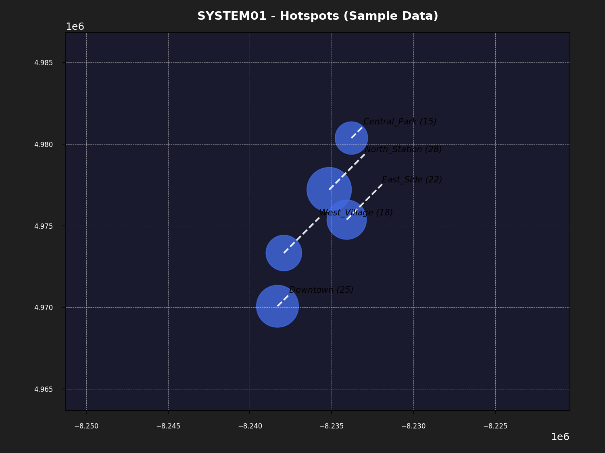
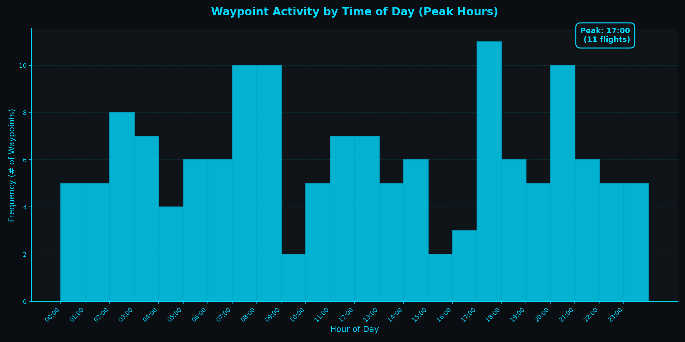

# Waypoint Scatter Plot

A system for visualizing waypoint flight data across multiple systems through geographic hotspot maps and temporal activity analysis.

## Project Structure

```
waypoint-scatter-plot/
├── analysis/                 # Waypoint analysis scripts
│   └── plot_waypoints_by_date.py
├── web_viewer/              # Flask web application
│   ├── app.py               # Main Flask app
│   ├── maphotspot.py        # Hotspot map generation
│   ├── templates/           # HTML templates
│   └── static/              # CSS and images
├── samples/                 # Sample data and demo scripts
│   ├── sample_plot.py       # Demo histogram generator
│   ├── sample_hotspot.py    # Demo hotspot map generator
│   ├── sample_waypoint_data.json
│   ├── sample_waypoint_plot.png
│   └── sample_SYSTEM01_hotspot.png
├── .env.example             # Environment variables template
└── README.md
```

## Environment Setup

Copy `.env.example` to `.env` and configure:

```bash
# Google Sheets (required for analysis)
GSHEET_NAME=your_sheet_name_here
GSHEET_WORKSHEET=1
GSHEET_DATA_START_ROW=3
DATE_FORMAT=%m/%d/%Y
TIME_FORMAT=%H:%M:%S

# Systems and time range
SYSTEMS=SYSTEM39,SYSTEM40,SYSTEM45,SYSTEM61,SYSTEM66,SYSTEM68,SYSTEM74
YEARS=2024,2025

# File paths (required for hotspot maps)
WAYPOINT_DATA_PATH=/path/to/waypoint_data_{month}_{year}.json
HOTSPOT_OUTPUT_PATH=/path/to/images/{system}_hotspot_{month}_{year}

# Flask server
FLASK_HOST=0.0.0.0
FLASK_PORT=5058

# Mapbox (optional for real maps)
mapboxtoken=your_token_here
```

## Usage

### Web Viewer (Flask App)

```bash
cd web_viewer
python app.py
# Visit http://localhost:5058
```

Displays interactive hotspot maps for each system. Maps update every hour automatically.

### Analysis: Waypoint Activity by Date

```bash
cd analysis
python plot_waypoints_by_date.py
```

Requires Google Sheets configured in `.env`.

## Sample Visualizations

### Hotspot Map: Geographic Distribution



Shows spatial distribution of waypoints for a system. Marker size represents waypoint count.

- **Blue circles:** Waypoint locations (Web Mercator projection)
- **Dashed lines:** Connection to labels
- **Count labels:** Number of waypoints at each location

### Waypoint Activity Histogram: Peak Times



Shows frequency distribution of waypoint activity by hour of day, highlighting peak flight times.

- **X-axis:** Hour of day (00:00–23:00)
- **Y-axis:** Frequency (number of waypoints)
- **Peak indicator:** Highest activity hour with count

## Sample Data

Run sample demos without real data:

```bash
# Generate sample hotspot map
cd samples
python sample_hotspot.py
# Output: sample_SYSTEM01_hotspot.png

# Generate sample activity histogram  
python sample_plot.py
# Output: sample_waypoint_plot.png
```

Uses `sample_waypoint_data.json` with NYC waypoint locations.

## Technologies

- **Backend:** Flask, APScheduler
- **Data:** Google Sheets (gspread), JSON
- **Mapping:** GeoPandas, Shapely, Contextily (Web Mercator)
- **Visualization:** Matplotlib
- **Frontend:** HTML/CSS (responsive design)